# Golosone Kiosk

**Un'interfaccia self-service moderna, a schermo intero, sopra un gestionale di cassa chiuso e senza API.**

Realizzata per la cassa touch del **Panificio e Pasticceria Il Golosone** (Cernusco sul Naviglio, MI),
che usa *Passepartout Retail* in modalità KIOSK. Il gestionale originale è pensato per il personale:
molti clienti, davanti a tastierino, colonne IVA e pulsanti piccoli, non capivano come pagare.

Golosone Kiosk si mette **sopra** Passepartout, lo legge e lo comanda in tempo reale, e al cliente
mostra solo tre passaggi: **scansiona → controlla → paga con carta**.
Passepartout resta il sistema vero (articoli, scontrino fiscale, POS): nessuna modifica al gestionale.

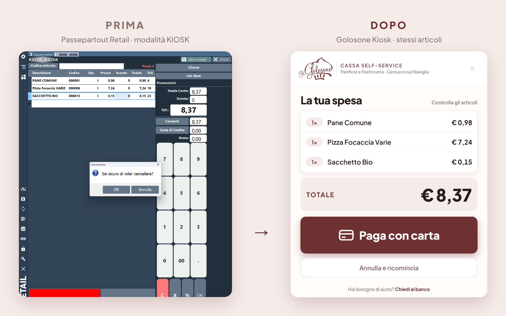

---

## Il percorso del cliente

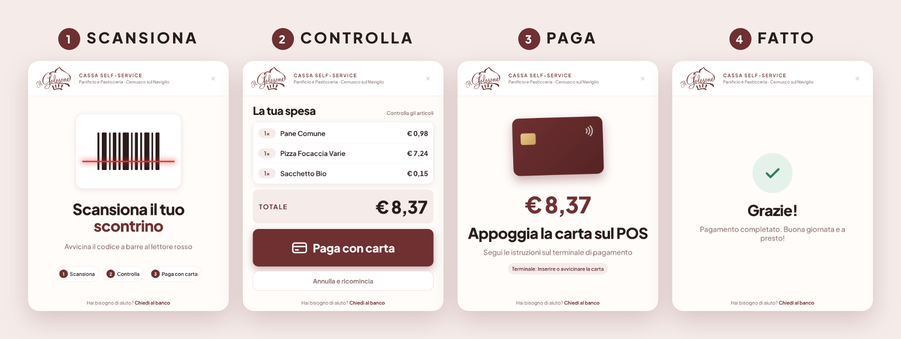

## Tutte le schermate

<table>
  <tr>
    <td align="center">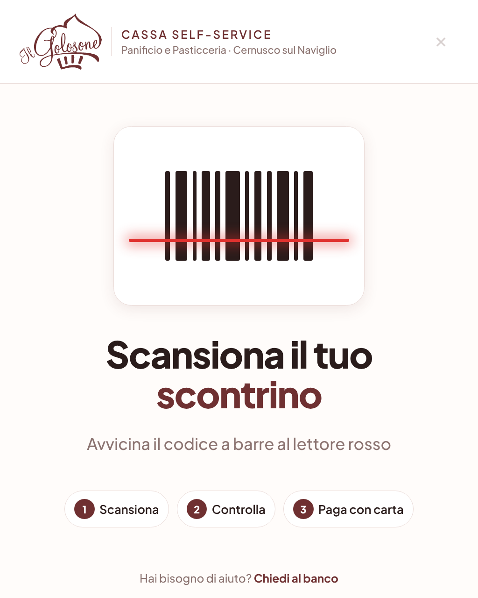<br><sub><b>Attesa</b>: istruzioni in 3 passi</sub></td>
    <td align="center">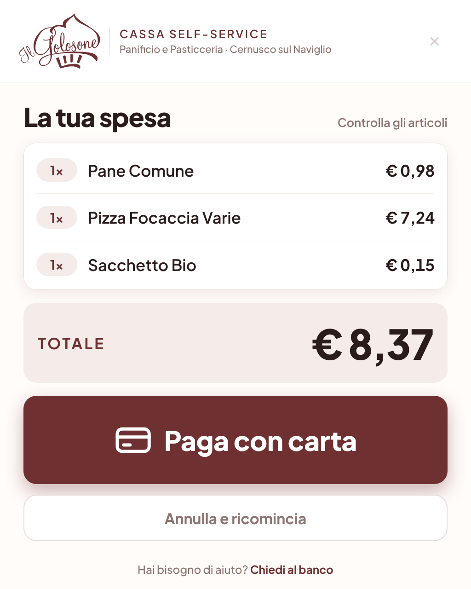<br><sub><b>Carrello</b>: letto da Passepartout in tempo reale</sub></td>
    <td align="center">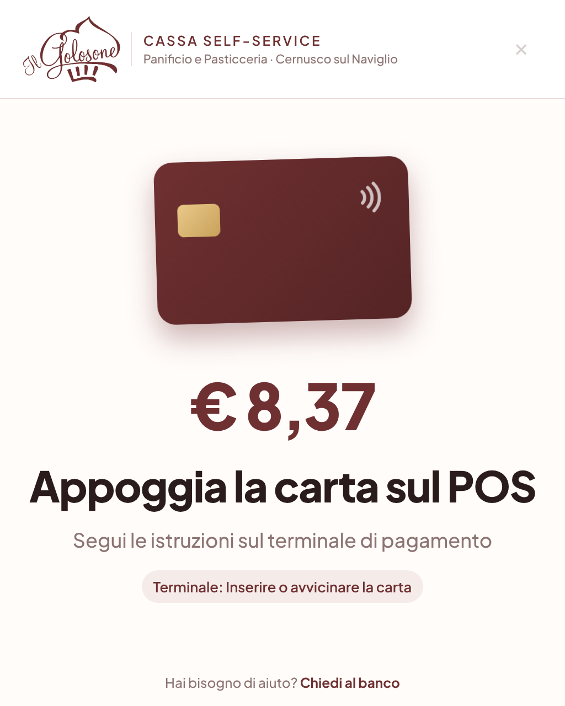<br><sub><b>Pagamento</b>: stato del POS in diretta</sub></td>
  </tr>
  <tr>
    <td align="center">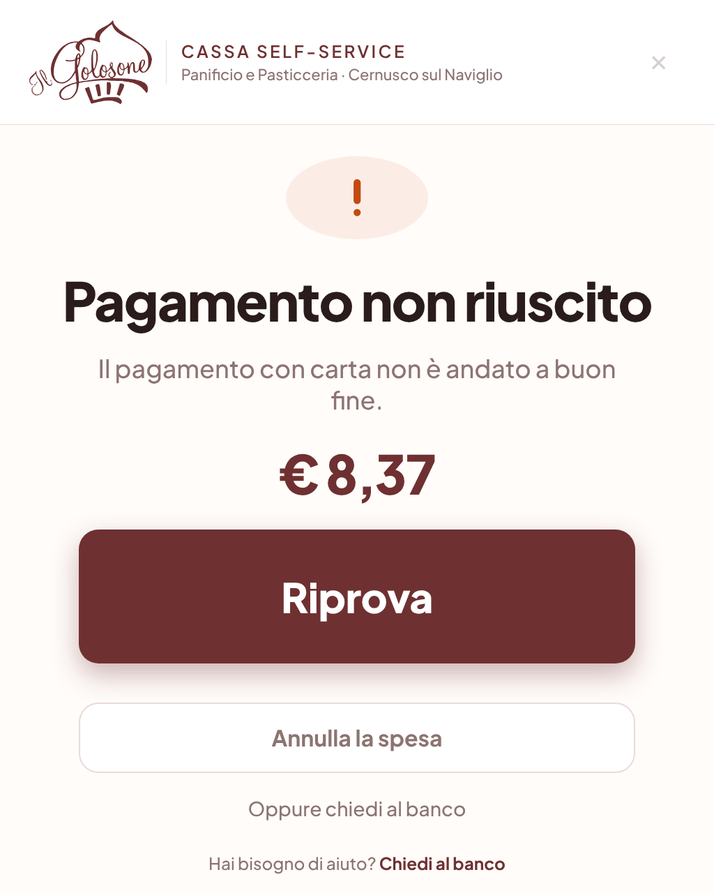<br><sub><b>Pagamento rifiutato</b>: riprova o annulla</sub></td>
    <td align="center">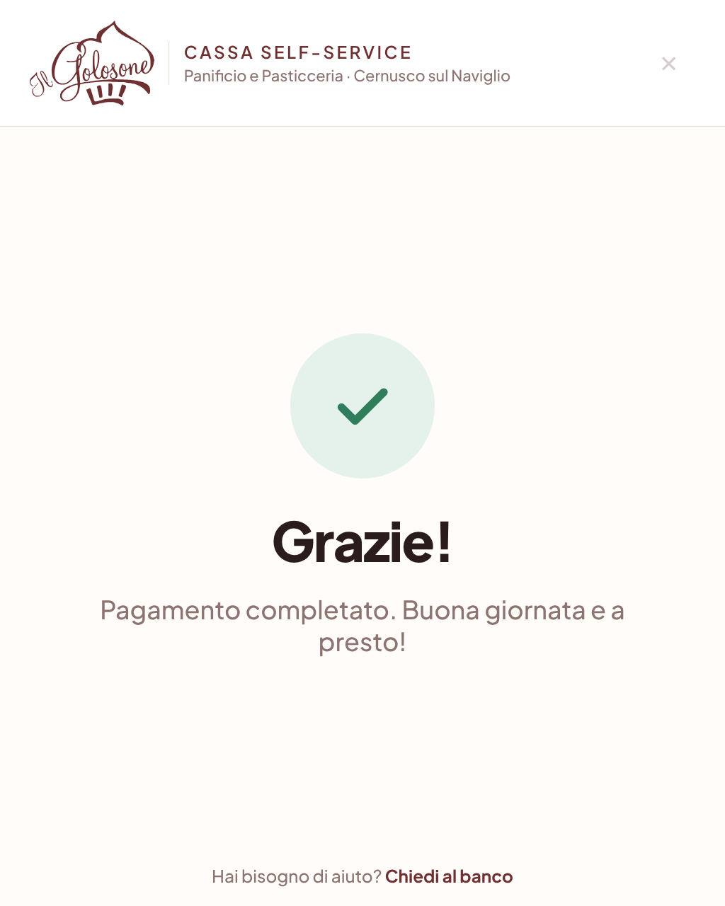<br><sub><b>Pagamento riuscito</b></sub></td>
    <td align="center">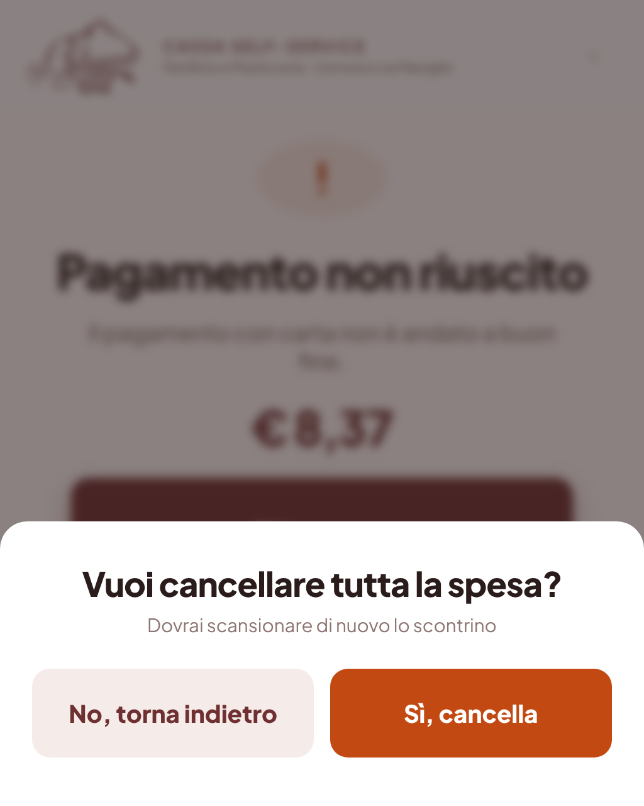<br><sub><b>Annulla spesa</b>: conferma anti-errore</sub></td>
  </tr>
  <tr>
    <td align="center">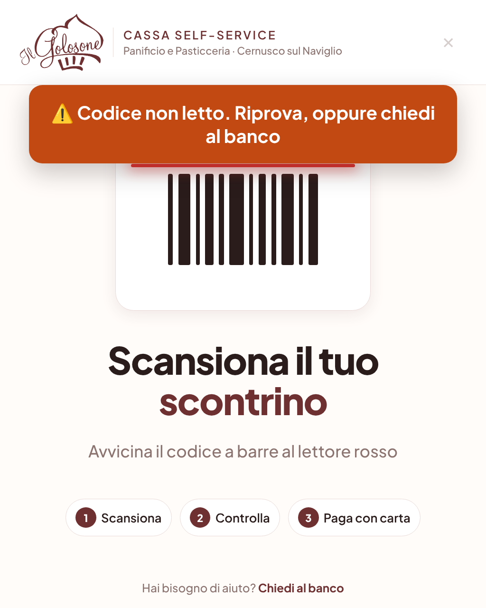<br><sub><b>Lettura non riuscita</b>: avviso chiaro</sub></td>
    <td align="center">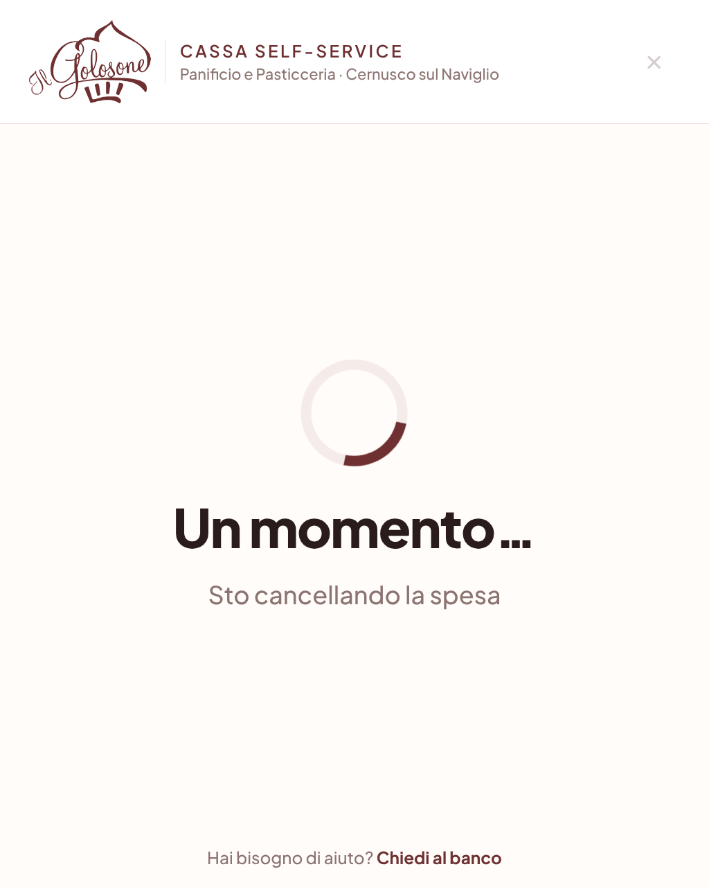<br><sub><b>Annullo in corso</b> su Passepartout</sub></td>
    <td align="center">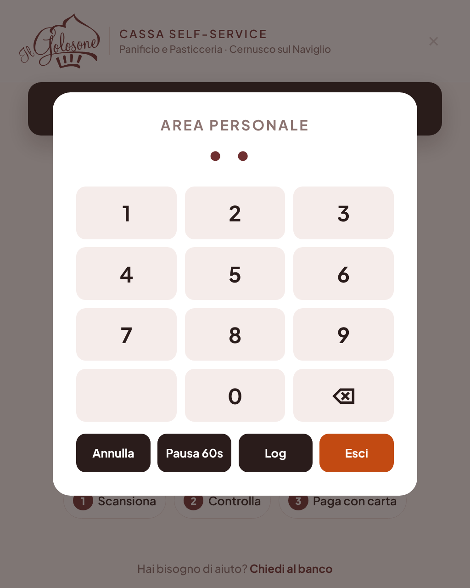<br><sub><b>Area personale</b>: PIN, pausa, log</sub></td>
  </tr>
</table>

---

## Cosa fa

- **Carrello in grande**: righe, quantità e totale letti da Passepartout mentre il cliente scansiona.
- **Pagamento con carta in un tocco**: preme il vero tasto di pagamento di Passepartout.
- **Popup del POS gestiti in automatico**: se la carta viene rifiutata o il PIN è errato, il programma
  chiude il popup, sceglie *Annulla* e propone al cliente **Riprova** / **Annulla la spesa**.
  Il pulsante *"Prosegui con emissione scontrino"* (scontrino senza pagamento) **non può essere premuto**: è bloccato nel codice.
- **Annulla spesa**: esegue da solo ☰ → Cancella → OK su Passepartout e verifica che il carrello sia vuoto.
- **Letture non riuscite**: avviso per il cliente; i popup di errore lettura vengono chiusi automaticamente.
- **Area personale** protetta da PIN: uscita, pausa di 60 s, visualizzazione del log a schermo.
- **Robusto**: se Passepartout è chiuso l'overlay si nasconde; un popup sconosciuto viene lasciato al personale;
  un watchdog registra nel log il punto esatto di un eventuale blocco.

## Architettura

```
┌──────────────────────────────────────────────┐
│  Overlay HTML/CSS/JS  (pywebview · WebView2) │  ← il cliente tocca qui
│  schermo intero · sempre in primo piano      │
└───────────────▲───────────────┬──────────────┘
         stato  │               │ comandi (paga, annulla)
┌───────────────┴───────────────▼──────────────┐
│  Thread di controllo Python                  │
│  · UI Automation: legge totale, pezzi, righe │
│  · clic attraverso l'overlay (click-through) │
│  · gestione popup POS / errori               │
└───────────────▲───────────────┬──────────────┘
                │ legge         │ clicca
┌───────────────┴───────────────▼──────────────┐
│  Passepartout Retail (KIOSK)  ← lettore codici│
└──────────────────────────────────────────────┘
```

| Parte | Tecnologia |
|---|---|
| Interfaccia | HTML/CSS/JS, font Plus Jakarta Sans incorporato, logo vettoriale |
| Finestra | `pywebview` (Edge WebView2), stili Win32 `WS_EX_NOACTIVATE` / `WS_EX_LAYERED` / `WS_EX_TRANSPARENT` |
| Lettura del gestionale | Windows UI Automation via `comtypes` (`FindFirst`, `CacheRequest`) e `pywinauto` |
| Interazione | `ctypes` su `user32` (chiamate asincrone), `SendInput`, hook tastiera passivo |
| Configurazione | `config.json`: ID dei controlli, macro, testi dei popup. Se il gestionale cambia layout si aggiorna la configurazione, non il codice |
| Distribuzione | aggiornamento automatico dalle GitHub Releases, con backup, verifica e ritorno automatico alla versione precedente (`avvia.py`) |

## Sfide tecniche

Il gestionale non ha API: tutto passa dall'interfaccia grafica di un programma di terzi.
Alcuni problemi reali risolti durante lo sviluppo e il collaudo in negozio:

| Problema | Causa | Soluzione |
|---|---|---|
| Lettura del carrello lentissima (2,1 s) | la ricerca dei controlli di `pywinauto` scorre in Python tutto l'albero UI, celle della griglia comprese | `FindFirst` nativo di UI Automation + cache dei controlli validata con `IsWindowVisible`; griglia letta con **una sola** `CacheRequest`. Da 2,14 s a **0,01 s** |
| Overlay bloccato ("non risponde") | deadlock: il thread di controllo chiamava la finestra in modo sincrono tenendo il GIL, mentre la finestra aspettava il GIL per rispondere | tutte le operazioni sulla finestra con `ctypes` e chiamate asincrone (`ShowWindowAsync`, `SWP_ASYNCWINDOWPOS`) |
| Il gestionale ignora i clic simulati | i pulsanti sono disegnati a mano e non accettano messaggi `WM_LBUTTONDOWN` | clic reali con `SendInput`, resi possibili rendendo l'overlay **trasparente ai clic** per una frazione di secondo: il cliente non vede mai il gestionale |
| Il lettore non scriveva nel gestionale | il lettore di codici è una tastiera: scrive nella finestra con il focus, e toccare l'overlay lo spostava | overlay `WS_EX_NOACTIVATE` + focus tenuto sul campo "Codice articolo"; hook tastiera solo in ascolto, per rilevare le letture non riuscite |
| Pulsanti "OK"/"Chiudi" non trovati nei popup | non sono `Button` standard per UI Automation e compaiono più volte nell'albero | ricerca per testo esatto sui figli Win32 del popup, poi clic reale |
| Stato del carrello non aggiornato dopo un annullo | il riferimento in memoria puntava a un controllo ricreato dal gestionale | validità della cache verificata sulla finestra reale del controllo, non sul riferimento UIA |

## Installazione

Su Windows, nel PC della cassa:

```bat
py -m pip install -r requirements.txt
copy config.example.json config.json
```

Modifica `staff_pin` in `config.json` (il file è escluso da git), poi:

```bat
py app.py --test     :: verifica che legga carrello, totale e pezzi
py app.py            :: avvia l'overlay
```

Per il personale: `crea_collegamento.bat` crea sul desktop il collegamento **Cassa Golosone**,
che avvia `avvia.py` (aggiornamento automatico + sorveglianza, senza finestra del prompt).

## Aggiornamenti automatici

Il collegamento sul desktop avvia `avvia.py`, che prima di aprire l'overlay controlla
le **Release** di questo repository:

- se c'è una versione più nuova di quella installata (`VERSION`), salva un backup,
  installa la nuova e aggiorna le librerie se `requirements.txt` è cambiato;
- `config.json` (PIN e impostazioni della cassa) **non viene mai sovrascritto**:
  le impostazioni nuove introdotte da una versione vengono solo aggiunte;
- una release con errori di sintassi viene rifiutata prima di toccare qualsiasi file;
- se la nuova versione va in errore entro 30 s, si torna da soli alla precedente;
- se l'overlay si chiude per un errore viene riavviato (massimo 5 volte all'ora).

Dall'area personale, il tasto **Aggiorna** cerca subito una nuova versione senza riavviare il PC.

**Pubblicare un aggiornamento**: fai commit e push su `main` (la cassa non cambia),
poi su GitHub → *Releases* → *Draft a new release* → tag più alto dell'ultimo
(es. `v1.2.0`) → *Publish*. Al successivo avvio, o premendo *Aggiorna*, la cassa si aggiorna.

## Adattarlo a un altro negozio con Passepartout Retail

1. Cambia logo (`ui/logo.svg`, `golosone.ico`) e testi (`brand` in `config.json`).
2. Con un carrello caricato lancia `py app.py --test`: devono risultare **OK** codice, totale, pezzi, griglia e pagamento.
   Se qualcosa manca, `python inspect_passepartout.py` stampa l'albero dei controlli da cui prendere gli `auto_id`.
3. Con `py app.py --calibra` verifica la posizione del pulsante ☰ (macro di annullo) se lo schermo è diverso da 1024×1280.
4. Controlla nel log i testi dei popup del tuo POS e, se servono, aggiornali in `pos_dialogs`.

## Diagnostica

| Comando | A cosa serve |
|---|---|
| `py app.py --test` | lettura singola dei controlli, con tempi e copie visibili/nascoste → `test_lettura.txt` |
| `py app.py --calibra` | coordinate e controllo sotto ogni tocco, per creare nuove macro |
| `python inspect_passepartout.py` | albero completo dei controlli di Passepartout |
| `kiosk_log.txt` / Area personale → Log | cronologia di letture, pagamenti, annulli, blocchi |

## Note

- Progetto indipendente, non affiliato a Passepartout / TeamSystem. I marchi citati appartengono ai rispettivi proprietari.
- In uso su una cassa reale (schermo verticale 1024×1280, Windows).

## Licenza

Codice: MIT (vedi `LICENSE`).
Il logo e il nome "Il Golosone" (`ui/logo.svg`, `golosone.ico`, schermate in `docs/`) **non** sono coperti
dalla licenza e restano di proprietà di Panificio e Pasticceria Il Golosone S.R.L.
